# Digimon Digital Card Battle (PS1) — Authoritative Engine Rules Specification

This document specifies the 1:1 battle engine rules for **Digimon Digital Card Battle** (PS1, Bandai 2000/2001 NA). Every rule, phase transition, calculation, and edge case is defined deterministically below. Where community documentation or original game behavior has minor ambiguity or configurable variants, a `RulesConfig` flag with an authoritative default is specified in [Section 11](#11-rulesconfig--edge-case-defaults).

---

## 1. Deck Construction Rules

1. **Deck Size**: Exactly **30 cards** (`deckSize = 30`). A deck with fewer or more than 30 cards is invalid.
2. **Copy Limits**:
   - **Standard Cards** (Level `R`, `C`, `U` Digimon and Option cards): Maximum **4 copies** of any single card ID (`maxCopiesPerCard = 4`).
   - **Partner Cards** (`level === 'R P'`, cards `175, 182, 183, 184, 187, 190`): Maximum **1 copy** per Partner card ID (`maxPartnerCopies = 1`), and at most **3 Partner cards total** in a deck (`maxTotalPartners = 3`, configurable).
   - **Armor Cards** (`level === 'A'`, cards `172–174, 176–181, 185–186, 188–189`): **Cannot be placed in a deck** (deck limit `0`). Armor forms are virtual evolutions chosen directly when deploying a Partner (`R P`) card during Rookie Placement.
3. **Rookie Requirement**: A valid deck should contain at least 1 Level `R` or `R P` Digimon card (`requireRookieInDeck = true`).

---

## 2. Game Zones

Each player has 6 distinct zones:

| Zone ID (`Zone`) | In-Game Name | Visibility | Ordering | Description |
| :--- | :--- | :--- | :--- | :--- |
| `online` | **Online Deck** | Hidden (count & top card back visible) | Ordered stack (top = index `0`) | Draw pile (starts at 30 cards). When it reaches `0` cards, examine [Deck-Out Rules](#82-deck-out-online-deck-reaches-0). |
| `hand` | **Hand** | Visible to owner; hidden to opponent (card backs / count visible) | Ordered list (max 4 in normal draw; can exceed 4 temporarily via Support draw effects) | Holds up to 4 cards during normal Draw Phase. Effects like `Draw 3 Cards` can push Hand size above 4 (up to `maxHandSizeCap = 10`). |
| `battle` | **Battle Area (Active Stack)** | Public | Stack (top = active Digimon; beneath = prior digivolution stages) | Contains the active Digimon card and any cards beneath it in its digivolution stack. Only the **top card's** stats, Level, Specialty, and Attacks are active. |
| `dpSlot` | **DP Slot** | Public (top card & total DP count/value visible) | Stack (top = most recently placed card) | Cards sacrificed from Hand for Digivolve Points (`+P`). Accumulates DP values across turns. **Persists across KOs!** |
| `support` | **Support / Option Slot** | Face-down when played; Public when revealed | Single card slot (0 or 1 card) | Holds the card played during the Battle Phase Support step (or Digivolve Phase Option step) until resolution completes, then moves to `offline`. |
| `offline` | **Offline Pile** | Public (top card & count visible) | Stack (top = most recently discarded card) | Discard pile for KO'd Digimon stacks, consumed DP cards, resolved Support cards, and milled/discarded cards. |

---

## 3. Card Properties & Level Ranking

### 3.1 Specialties (`Specialty`)
There are 5 Specialties:
- `Fire` (Red)
- `Ice` (Blue)
- `Nature` (Green)
- `Darkness` (Black)
- `Rare` (Yellow)

### 3.2 Levels (`Level`) & Level Rank (`levelRank`)
Digimon cards have one of 5 printed `Level` strings: `'R'`, `'R P'`, `'A'`, `'C'`, `'U'`.
Whenever an effect compares levels (`levelCompare`, `"If own Level is lower"`, `"If own Level is below opponent's"`), levels are mapped to numerical ranks:

| Printed Level | Meaning | `levelRank` (Default) | Notes |
| :--- | :--- | :---: | :--- |
| `'R'` | Rookie | `1` | Base entry level. Can be placed directly into the Battle Area. |
| `'R P'` | Rookie Partner | `1` | Treated as Level `R` (`rank = 1`) for entry, level comparisons, and `Level === 'R'` checks (configurable via `partnerCountsAsRookieForEffects = true`). Can also Armor Digivolve. |
| `'A'` | Armor | `2` | Treated as Champion-tier (`rank = 2`) for relative level comparisons (`R < A = C < U`), Configurable via `armorLevelRank = 2`. For exact level checks (`levelIs: ['C']` vs `levelIs: ['A']`), `'A'` only matches `'A'`. |
| `'C'` | Champion | `2` | Digivolves from `R` (or `R P`). |
| `'U'` | Ultimate | `3` | Digivolves from `C`. |

---

## 4. Game Setup, Coin Toss & Mulligan

1. **Determine First Player**: Flip a coin (or rock-paper-scissors / configured starting player) to determine **Player 1 (Turn Player on Turn 1)** and **Player 2**.
2. **Initial Shuffle & Draw**: Both players shuffle their 30-card `online` deck and draw **4 cards** into `hand` (`online` now has 26 cards).
3. **Rookie Check & Mulligan**:
   - Each player checks if their 4-card Hand contains at least one playable Rookie (`level === 'R'` or `level === 'R P'`).
   - **If a player has at least one `R` / `R P`**: They may optionally redraw (if `allowVoluntaryMulligan = true`, default `true` once in PS1) or keep their hand.
   - **If a player has NO `R` / `R P` in hand**:
     - The player reveals their hand, returns all 4 cards to their `online` deck, shuffles, and draws 4 new cards.
     - Repeat up to `maxForcedMulligans = 10` times. If a deck contains no `R`/`R P` cards at all (or fails after max redraws), that player immediately loses the match.
4. **Initial Active Digimon Placement**:
   - Both players simultaneously select 1 Level `R` or `R P` card from their Hand and place it face-down into their `battle` zone (Hand now has 3 cards).
   - Both Active Digimon are revealed simultaneously. Their current `hp` is initialized to their printed `hp` (`maxHp`).

---

## 5. Turn Alternation & Phase Structure

### 5.1 How Turns Alternate in DDCB
In *Digimon Digital Card Battle*, a **Turn** consists of **both players** completing their Preparation (Draw + Digivolve) phases sequentially, followed by a **shared Battle Phase** where one player has the **First Attack initiative (Turn Player / Offence)** and the other player is the **Second Player (Defence)**:

1. **Turn Player (`activePlayer`)** executes:
   - **Draw Phase**: Draws cards from `online` until `hand.length === 4` (if `hand.length >= 4`, draws 0 cards).
   - **Entry Step** (only if Turn Player's `battle` zone is empty after being KO'd last turn or at match start): Must place 1 Level `R` or `R P` Digimon from Hand into `battle`. When placing a **Partner (`R P`)** card, the player chooses either to **Armor Evolve** it immediately at `0 DP` into one of its Armor (`A`) forms (Veemon has 3; the other Partners have 2) or to deploy it as a **Normal Rookie (`R P`)** that can Digivolve normally into Champion (`C`) and Ultimate (`U`) forms. (See [Section 8.1](#81-ko--new-rookie-entry-and-redraw) if no Rookie is in Hand).
   - **Digivolve / Preparation Phase**:
     - May add **at most 1 Digimon card** from Hand to `dpSlot` (`+P`).
     - May play Digivolve-phase Option cards (`timing: 'digivolvePhase'`, Cards `293–300`) whenever they have an active Digimon — even if the Option produces no Digivolution (in which case it is simply discarded to `offline`).
     - May Digivolve their active Digimon (one or more steps, e.g., `R -> C -> U` or `R P -> C -> U`, provided DP and level rules are met).
2. **Non-Turn Player (`opponentPlayer`)** executes:
   - **Draw Phase**: Draws cards from `online` until `hand.length === 4`.
   - **Entry Step** (only if Non-Turn Player's `battle` zone is empty after being KO'd last turn): Must place 1 Level `R` or `R P` Digimon from Hand into `battle` (with the Partner Armor / Normal Rookie choice if placing `R P`).
   - **Digivolve / Preparation Phase**:
     - May add **at most 1 Digimon card** from Hand to `dpSlot` (`+P`).
     - May play Digivolve-phase Option cards (`293–300`) anytime while having an active Digimon.
     - May Digivolve their active Digimon.
3. **Shared Battle Phase**:
   - **Attack Choice Step**: Both players secretly/sequentially select an attack (`circle` ○, `triangle` △, or `x` ✕) on their Active Digimon.
   - **Support Step**: Both players may play at most **1 Battle Support Card** (either a Digimon or Battle Support Option `#191–#292` from `hand` — never Digivolve Options `#293–#300` — OR blind-play the **top of `online` deck**), or pass.
     - *Turn Order in Support Selection*: Turn Player selects/passes first, then Non-Turn Player selects/passes (or simultaneous selection in UI; revealed and resolved in defined order).
   - **Combat Resolution Step**: Support effects, X-attack abilities, First Attack Damage, Second Attack Damage, Counterattacks, and Post-Attack effects resolve.
   - **Post-Battle Cleanup Step**: Support cards go to `offline`; KO'd Digimon stacks go to `offline` and award +1 KO point; surviving Digimon **keep their current HP and active status** into the next turn.
4. **Next Turn Handover**:
   - The **Turn Player (`activePlayer`)** role alternates to the other player for the next turn (`Turn 1: P1 first, Turn 2: P2 first, Turn 3: P1 first...`).
   - *Rule Note*: By default, the player who is `activePlayer` attacks first in the Battle Phase unless overridden by `1st Attack`, `attackFirst`, or `attackSecond` effects.

---

## 6. Preparation / Digivolve Phase Rules

During a player's Preparation Phase, they may perform the following actions in any order before confirming **"Done / To Battle"**:

### 6.1 Adding a Card to the DP Slot (`+P`)
- **Limit**: Once per turn per player (`maxDpAttachmentsPerTurn = 1`).
- **Eligible Cards**: Only **Digimon cards** (`kind === 'digimon'`) have a `+P` (`pp`) value and can be placed into the `dpSlot`. Option cards cannot be placed in the DP Slot.
- **Effect**: The chosen card moves from `hand` to the top of `dpSlot`. The player's accumulated DP increases by that card's printed `pp` (typically `10`, `20`, or `30`).

### 6.2 Playing Digivolve-Phase Option Cards
Option cards with `timing === 'digivolvePhase'` (Cards `293–300`) can **only** be played during the Preparation / Digivolve Phase while the player has an active Digimon (never from hand during Battle Support Step). They are always playable in the Preparation Phase regardless of whether the resulting effect can digivolve a card in hand (if it does not, the Option card is simply discarded to `offline`):
- **293 Download Digivolve**: Next digivolution this phase ignores Specialty, Level, and DP requirements (`ignoreSpecialty`, `ignoreLevel`, `ignoreDp`).
- **294 ArmorCrush Digivolve**: Allows an active Level `A` Digimon to digivolve to a Level `C` or `U` Digimon of matching Specialty (DP is still required and consumed!).
- **295 Special Digivolve**: Next digivolution this phase ignores Specialty and grants `+20` virtual DP (`ignoreSpecialty`, `extraDp: 20`).
- **296 Mutant Digivolve**: Allows an active Digimon to digivolve into another Digimon of the **same Level** (`R->R`, `C->C`, `U->U`), ignoring Specialty, while still requiring and consuming DP (`allowSameLevel`, `ignoreSpecialty`).
- **297 Warp Digivolve**: Allows an active Level `R` (or `R P`) Digimon to digivolve directly to Level `U` of matching Specialty, requiring and consuming only the Level `U` card's printed DP (`allowSkipLevel`).
- **298 De-Armor Digivolve**: Downgrades an active Level `A` Digimon back to the Level `R` / `R P` card beneath it in the `battle` stack (top virtual Level `A` form disappears cleanly without entering `offline`; underlying `R`/`R P` becomes active with its printed max HP).
- **299 Speed Digivolve**: Next digivolution this phase ignores DP requirements (`ignoreDp`). Does not consume DP Slot cards!
- **300 Digi-devolve**: Downgrades own digivolved Digimon (`U -> C` or `C -> R`/`R P`) by discarding the top card of the `battle` stack to `offline`. When successful, the revealed lower-level Digimon's HP becomes **double** its printed max HP (`hp = maxHp * 2`). If used on a non-`C`/`U` or unstacked Digimon, the Option has no effect and is simply discarded to `offline`.

### 6.3 Normal Digivolution (`R -> C`, `C -> U`)
To normally digivolve an active Digimon using a card from `hand`:
1. **Level Progression**:
   - Active `R` or `R P` $\rightarrow$ Hand `C`
   - Active `C` $\rightarrow$ Hand `U`
   *(Unless modified by Download, Mutant, Warp, or ArmorCrush Digivolve).*
2. **Specialty Match**:
   - The Hand card's printed `Specialty` must equal the Active Digimon's **current** `Specialty`.
   *(Unless modified by Download, Special, or Mutant Digivolve).*
3. **DP Requirement**:
   - The sum of `pp` of all cards currently in the player's `dpSlot` (plus any `extraDp` from *Special Digivolve*) must be $\ge$ the Hand card's printed `dp` cost.
   *(Unless `ignoreDp` is active from Download or Speed Digivolve).*
4. **DP Slot Consumption**:
   - When a normal digivolution (or DP-requiring Option digivolution) occurs, **all cards currently in the player's `dpSlot` are discarded to `offline`**. (Even if the player had 50 DP in the slot and only needed 40 DP, the entire DP Slot is emptied into `offline`).
   - *Exception*: If `ignoreDp: true` (via *Speed Digivolve* `299` or *Download Digivolve* `293`) is used, **DP Slot cards are NOT discarded** (configurable via `speedDigivolveKeepsDpSlot = true`).
5. **Stacking & HP Reset on Digivolution**:
   - The Hand card is placed on top of the `battle` stack.
   - The Active Digimon's `hp` is set to the new card's printed `hp` (`maxHp`), **regardless of how much damage the previous form had taken**.
   - **Same-Specialty Digivolve Bonus**: In DDCB, normal digivolution resets HP to the new card's printed `hp` (or if `sameSpecialtyHpBonus` is configured, adds the bonus; default is `0` / exact printed HP).

### 6.4 Armor Evolution (`R P -> A` on Entry)
Level `A` (Armor) Digimon are virtual evolutions invoked directly when playing a **Partner Rookie (`level === 'R P'`)** during Rookie Placement:
1. **Partner Choice on Entry (Veemon = 3, Others = 2)**:
   - Whenever a player places a Partner (`R P`) card into the empty `battle` zone (at match start or after a KO), they choose either to evolve it immediately into one of its canonical Armor (`A`) forms (with the Partner `R P` card placed underneath as its stack) **or** to deploy it as a **Normal Rookie (`R P`)**.
   - If kept as a Normal Rookie (`R P`), it behaves as a standard Rookie and may digivolve normally into matching Champion (`C`) and Ultimate (`U`) forms in subsequent Digivolve phases.
   - Specifically, the canonical Partner $\rightarrow$ Armor mappings in DDCB are:
     - **175 Veemon (`R P`, Fire)** $\rightarrow$ `172 Flamedramon` (`A`, Fire), `173 Magnamon` (`A`, Fire), `185 Raidramon` (`A`, Darkness) **(3 forms)**
     - **182 Hawkmon (`R P`, Nature)** $\rightarrow$ `179 Halsemon` (`A`, Nature), `188 Shurimon` (`A`, Rare) **(2 forms)**
     - **183 Patamon (`R P`, Nature)** $\rightarrow$ `174 Baronmon` (`A`, Fire), `180 Pegasusmon` (`A`, Nature) **(2 forms)**
     - **184 Gatomon (`R P`, Nature)** $\rightarrow$ `178 Tylomon` (`A`, Ice), `181 Nefertimon` (`A`, Nature) **(2 forms)**
     - **187 Wormmon (`R P`, Darkness)** $\rightarrow$ `177 Quetzalmon` (`A`, Ice), `186 Shadramon` (`A`, Darkness) **(2 forms)**
     - **190 Armadillomon (`R P`, Rare)** $\rightarrow$ `176 Submarimon` (`A`, Ice), `189 Digmon` (`A`, Rare) **(2 forms)**
2. **Zero DP Cost, DP Slot Preservation, & 30-Card Conservation**:
   - Armor cards cannot be added to a deck (`0` copies allowed).
   - Evolving into Armor on Partner entry requires **0 DP** and **DOES NOT discard cards in the `dpSlot`!**
   - Sets active `hp` to the Armor Digimon's printed `hp`.
   - Because Armor forms do not come from the 30-card deck, when an active Armor Digimon is KO'd or De-Armored (`#298`), only the underlying deck cards in its stack (`[partnerId, ...]`) move to `offline` — the virtual Level `A` card never enters `offline`, `hand`, or `online`.

---

## 7. Battle Phase & Resolution Order

### 7.1 Step 1 — Attack Selection
Both players select one of their Active Digimon's three attacks:
- `circle` (○)
- `triangle` (△)
- `x` (✕)

### 7.2 Step 2 — Support / Option Selection
Each player chooses one of three options for their Support Slot:
1. **Play from Hand**: Select 1 Battle-Support card from `hand` (a `Digimon` card or a Battle Support `Option` card `#191–#292` — **never** a Digivolve-phase Option `#293–#300`) and place it face-down in `support`.
2. **Play from Top of Online Deck (Blind Support)**: Take the top card (`index 0`) of `online` without looking at it first and place it face-down in `support`. (Requires `online.length >= 1`). If a Digivolve-phase Option card (`#293–#300`) is blind-flipped here, it has no Support effect and fizzles directly to `offline` during cleanup.
3. **Pass**: Play no Support card.

### 7.3 Step 3 — Pre-Combat Effect Resolution Order
Once both players have locked in their Attack and Support choices, the engine initializes each player's **Battle State**:
- `chosenAttack`: `'circle' | 'triangle' | 'x'`
- `attackPower`: `{ circle: baseC, triangle: baseT, x: baseX }` (initialized to the active card's printed values)
- `specialty`: initialized to the active card's printed `specialty`
- `grantedAbilities`: initialized to the active card's printed `xEffect` **only if the player's `chosenAttack === 'x'`** (see [Section 7.4](#74-step-4--cross-attack-x-effect-abilities) for dynamic changes!).

Then effects resolve in the following strict sequence:

#### Substep 3A: Void Support Pre-Check
Before executing general support ops, check if either player's Support Card contains a `voidSupport` operation (e.g., `036 MetalSeadramon`, `043 WaruSeadramon`, `080 Piximon`, `152 Starmon`, `168 ClearAgumon`, `253 Cherrymon's Mist`, `289 Mystic Sevens`):
1. Evaluate in player order (**Turn Player first, then Non-Turn Player**):
   - Note on `scope`:
     - `scope: 'support'` (`"Opponent's Support Effect is voided"`): Voids the opponent's Support card **only if the opponent's Support card is a Digimon card** (`kind === 'digimon'`). Option cards (`kind === 'option'`) are NOT voided by `'support'`! (Configurable via `supportVoidOnlyAffectsDigimon = true`; in PS1 DDCB, "Support Effect" specifically refers to a Digimon card's Support Effect, whereas Option cards have "Option Effects", which is why `253 Cherrymon's Mist` and `289 Mystic Sevens` explicitly state `"Opponent's Support and Option Effects are voided"`).
     - `scope: 'supportAndOption'` (`"Opponent's Support and Option Effects are voided"`): Voids the opponent's Support card regardless of whether it is a Digimon or an Option card.
   - If Player A's `voidSupport` condition is met and voids Player B's card, Player B's Support card is marked `voided = true` and its ops will NOT execute (including if Player B also played a `voidSupport` card — because Turn Player resolves first, Turn Player's void cancels Non-Turn Player's void before Non-Turn Player's void can fire!).
   - *Important*: Any secondary effect on the voiding card itself (e.g., `080 Piximon`: `"Opponent's Support Effect is voided. Own Attack Power is halved"`, or `289 Mystic Sevens`: `"His Attack Power is 0"`) still executes during Substep 3B.

#### Substep 3B: Support & Option Effect Execution
1. **Turn Player's Support Card** (if present and not `voided`):
   - Execute its `ops` list top-to-bottom.
   - If the op is `useTopCardSupport` (if triggered), fetch the top card of `online`, discard it to `offline`, and execute its support `ops` inline.
2. **Non-Turn Player's Support Card** (if present and not `voided`):
   - Execute its `ops` list top-to-bottom.

> **Crucial Ordering Interaction**:
> Because Turn Player's Support resolves before Non-Turn Player's Support:
> - If Turn Player forces an attack change (`forceAttack`) or changes Specialty (`setSpecialty`), that change is already in place when Non-Turn Player's Support evaluates conditions like `attackIs` or `specialtyIs`.
> - Conversely, if Non-Turn Player's Support forces an attack change (`Opponent uses [[circle]]`), it overrides Turn Player's attack choice *after* Turn Player's Support has already resolved.
> - However, if Turn Player played a conditional Hitter card (e.g., `249 Circle Hitter`: `"If opponent uses [[circle]], attack first and boost own Attack Power +500"`), it checks the opponent's chosen attack at the moment it resolves.

#### Substep 3C: Determine Final Chosen Attacks & Active Abilities
After both Support cards have finished resolving:
1. Each player's `chosenAttack` is now finalized (`'circle' | 'triangle' | 'x'`).
2. **Active Cross-Attack (`xEffect`) Ability Check**:
   - A Digimon's printed `xEffect` ability (e.g. `[[circle]] Counter`, `[[circle]] to 0`, `1st Attack`, `Ice Foe x3`, `Eat-Up HP`, `Jamming`, `Crash`) is active **if and only if**:
     - That player's **final** `chosenAttack === 'x'` (including if forced into `'x'` by an effect like `Giromon` or `Saberdramon`, and NOT active if forced *out* of `'x'` into `'circle'` or `'triangle'`), **AND**
     - Neither player's active ability has **Jamming** active (see Jamming below), **AND**
     - `removeAbility` has not been applied to that player.
   - **Support-Granted Abilities (`grantAbility`)**:
     - Abilities granted by a Support/Option card (such as `041 Panjyamon` granting `[[triangle]] Counter`, `191 Golden Banana` granting `any Counter`, `205 Dark Bone` / `073 Rosemon` granting `Eat-Up HP`) apply to the player's **currently chosen attack** regardless of whether it is `circle`, `triangle`, or `x`.
     - If **Jamming** is active on either Digimon's `x` attack, Jamming disables printed `xEffect` abilities on the opponent (configurable whether Jamming also blocks Support-granted abilities; default `jammingBlocksPrintedXEffectOnly = false`, i.e., Jamming prevents `xEffect` abilities during combat).

### 7.4 Step 4 — Cross-Attack (`xEffect`) Abilities
After Support cards resolve and before damage is dealt, evaluate active `xEffect` and `grantAbility` modifiers in the following order:

1. **`Jamming`**:
   - Text: `"Jamming"`
   - Effect: Nullifies the opponent's `xEffect` ability for this battle (including `Counter`, `[slot] to 0`, `<Specialty> Foe x3`, `1st Attack`, `Eat-Up HP`, `Crash`).
   - *Note*: Jamming is an `xEffect` ability that takes effect at the start of Step 4; it does **not** undo Support/Option card stat changes that already resolved in Step 3B (cards `043 WaruSeadramon` and `168 ClearAgumon` also have `voidSupport` as their *Support* effect, which is separate from their printed `Jamming` X-attack effect).
2. **`<Specialty> Foe x3` (`foeX3`)**:
   - Text: `"Fire Foe x3"`, `"Ice Foe x3"`, `"Nature Foe x3"`, `"Darkness Foe x3"`, `"Rare Foe x3"` (Note: `070 Seraphimon` writes `"Dark Foe x3"` which is synonymous with `"Darkness Foe x3"`).
   - Effect: If the opponent's **current** `Specialty` matches the named Specialty, multiply own `x` Attack Power by **3** (`attackPower *= 3`).
3. **`[slot] to 0` (`toZero`)**:
   - Text: `"[[circle]] to 0"`, `"[[triangle]] to 0"`, `"[[x]] to 0"`
   - Effect: If the opponent's **final** `chosenAttack` equals `slot`, set the opponent's chosen Attack Power to **0** (`opponent.attackPower[slot] = 0`).
   - *Ordering Note*: `[slot] to 0` applies **after** Support boosts and `<Specialty> Foe x3`, so if Player A's `[circle] to 0` triggers against Player B's `circle`, Player B's `circle` Attack Power becomes `0` even if Player B boosted it with a Support card!

### 7.5 Step 5 — Attack Order Determination (`1st Attack`, `attackFirst`, `attackSecond`)
Determine who is the **First Attacker** and who is the **Second Attacker**:
1. **Default**: The **Turn Player (`activePlayer`)** is First Attacker; the **Non-Turn Player (`opponentPlayer`)** is Second Attacker.
2. **Priority Overrides**:
   - Each player has an attack-order modifier state: `'normal'` (default), `'first'` (from printed `1st Attack` on `x` or Support `attackFirst`), or `'second'` (from Support `attackSecond`, e.g., Counterattack supports like `041 Panjyamon`, `042 MegaSeadramon`, `076 Silphymon`, `191 Golden Banana`).
   - If a player receives both `attackFirst` and `attackSecond` from different sources, the **most recently applied** modifier wins (Support `attackSecond` / `attackFirst` overrides printed `1st Attack` if conflicting on the same player).
   - Compare the two players' final modifiers:
     - `'first'` beats `'normal'` and `'second'`.
     - `'normal'` beats `'second'`.
     - **Tie-breaker**: If both players have the **same** modifier (both `'first'`, both `'normal'`, or both `'second'`), the **Turn Player (`activePlayer`)** attacks first!

### 7.6 Step 6 — Damage & Combat Execution

#### Case A: Normal Combat (Neither player has a triggering `Counter` ability)
1. **First Attacker Attacks**:
   - Deal damage equal to `max(0, firstAttacker.chosenAttackPower)` to `secondAttacker.hp`.
   - `secondAttacker.hp = max(0, secondAttacker.hp - damage)`.
   - **Immediate Post-Hit Effects for First Attacker**:
     - **`Eat-Up HP`**: If First Attacker has `eatUpHp` active, First Attacker recovers HP equal to the **actual damage dealt** (capped by opponent's remaining HP before the hit if `eatUpHpCappedByRemainingHp = false`, or uncapped equal to attack power — see [Section 7.7](#77-special-combat-abilities-counter-eat-up-hp-crash)).
     - **`Crash`**: If First Attacker has `crash` active, see [Crash Rules](#773-crash).
2. **Check Second Attacker Survival**:
   - If `secondAttacker.hp <= 0` (or if First Attacker's `Crash` reduced both to 0):
     - Second Attacker is **KO'd immediately** and **DOES NOT execute their attack**. Combat ends.
3. **Second Attacker Attacks** (if `secondAttacker.hp > 0` and `firstAttacker.hp > 0`):
   - Deal damage equal to `max(0, secondAttacker.chosenAttackPower)` to `firstAttacker.hp`.
   - `firstAttacker.hp = max(0, firstAttacker.hp - damage)`.
   - **Immediate Post-Hit Effects for Second Attacker**:
     - Resolve `Eat-Up HP` or `Crash` for Second Attacker if active.

#### Case B: Counterattack (`[slot] Counter` / `any Counter`)
How **Counter** works in DDCB:
- A player has an active Counter for `slot` (`'circle'`, `'triangle'`, `'x'`, or `'any'` from `191 Golden Banana`) if:
  - Their chosen attack is `'x'` and their printed `xEffect` is `[[slot]] Counter` (and not Jammed), **OR**
  - Their Support card granted `{ kind: 'counter', slot }` (note: Support counter cards also explicitly include `attackSecond`).
- **Trigger Condition**: Counter triggers **if and only if**:
  1. The Counter user is the **Second Attacker** (Wait/Defence position), **AND**
  2. The **First Attacker's** final `chosenAttack` matches `slot` (or `slot === 'any'`), **AND**
  3. The Counter user **survives** the First Attacker's hit (`counterUser.hp > 0` after First Attacker's damage is subtracted!).
- **What happens if Counter User is First Attacker?**
  - If a Digimon with a `0`-power Counter attack attacks **first** (e.g., Turn Player chooses `✕` with `[[circle]] Counter (0)` and Opponent does NOT have `1st Attack`), the Counter user attacks first for their current Attack Power (base `0` + any Support boosts), and **does NOT counterattack** after the Second Attacker hits! (This is why Counter Support cards always include `"Attack second."`).
- **What happens when Counter Triggers (Counter User is Second Attacker, hit by matching `slot`, and survives with `hp > 0`)?**
  1. First Attacker deals their attack damage (`D_first`) to Counter User.
  2. Counter User survives (`counterUser.hp > 0`).
  3. Counter User immediately counterattacks, dealing **`D_first * 2` (double the Attack Power of the First Attacker's attack that just hit them)** PLUS any Attack Power the Counter User currently has on their own chosen attack (`counterDamage = (firstAttacker.chosenAttackPower * 2) + counterUser.chosenAttackPower`; configurable via `counterFormula = 'doubleOpponentPlusOwn'`).
     - *Wait — verify canonical DDCB Counter damage formula!*
     - In PS1 DDCB, all printed Counter attacks have base power `0` (`Powerful Flame (0), [[circle]] Counter`). If you boost own Attack Power (e.g., `006 RealMetalGreymon`: `"Boost own Attack Power +300"`), your Counter attack's own power becomes `300`. When Counter triggers, does it deal `opponentAttack * 2 + ownAttack` or `(opponentAttack + ownAttack) * 2` or does Counter set base power to `opponentAttack * 2` before/after boosts?
     - In DDCB, during Support phase, boosting own Attack Power raises the displayed number on your attack slot (e.g. from `0` to `300`). When the opponent hits you with the matching symbol, the Counter animation plays and reflects **double the opponent's Attack Power** added to your own Attack Power (or if `ownAttack` is `0`, simply `2 * opponentAttackPower`). If the opponent fails to match the symbol, the Counter User still attacks second for their own `counterUser.chosenAttackPower` (e.g., `300` if boosted, or `0` if unboosted)!
     - Both cases are unified cleanly by:
       - **If Counter triggers**: Damage dealt by Counter User = `(firstAttacker.chosenAttackPower * 2) + counterUser.chosenAttackPower` (default in `RulesConfig.counterIncludesOwnBoost = true`).
       - **If Counter does NOT trigger** (opponent used a different symbol): Counter User still attacks normally as Second Attacker for `counterUser.chosenAttackPower` (`0` if unboosted, or their boosted power).

### 7.7 Special Combat Abilities (`Counter`, `Eat-Up HP`, `Crash`)

#### 7.7.1 `Eat-Up HP`
- When an attack with `Eat-Up HP` deals damage to the opponent, the attacker immediately recovers HP equal to the damage dealt (`hp += damageDealt`).
- **HP Cap on Eat-Up HP & Support Recovery**:
  - In DDCB, can HP exceed printed `maxHp`?
  - **Yes!** Both Support HP recovery (`Recover own HP by +200`) and `Eat-Up HP` (as well as `Whamon` setting HP to 700, `Kokatorimon` doubling HP, and `Digi-devolve` doubling HP) **can raise a Digimon's current HP above its printed `maxHp`** (up to `9990`, configurable via `capHpAtMax = false`).

#### 7.7.2 `Crash`
- Printed on cards like `025 BomberNanimon`, `028 Solarmon`, `103 Apokarimon`, `105 Diaboromon`, `108 Machinedramon`, `124 Guardromon`, `125 Tekkamon`, `146 Giromon`, `166 Hagurumon`. All printed `Crash` attacks have a base power of `0`.
- **How `Crash` Works in DDCB**:
  - When the `Crash` user's turn to attack arrives (and `Crash` is not Jammed):
    1. The `Crash` user's Attack Power becomes equal to their **current HP** (plus any Attack Power boosts already on their `x` attack: `crashDamage = crashUser.hp + crashUser.chosenAttackPower`).
    2. That `crashDamage` is dealt to the opponent's HP.
    3. The `Crash` user's own HP drops to **`10` HP** (`crashSelfRemainingHp = 10` in PS1 DDCB — in DDCB, "Crash" reduces own HP to 10 and deals own previous HP as damage! Wait: what if `crashSelfKo = false` vs `true`? Let's document both in `RulesConfig`: in PS1 DDCB, Crash converts your current HP into Attack Power and leaves you with **10 HP** so that if the opponent survives and attacks second, almost any hit KOs you, whereas if the opponent is KO'd by the Crash hit, you survive at 10 HP! This is also why `105 Diaboromon` and `021 Tankmon` have Support effects `"Own HP become 10"` as an anti-Crash / low-HP mechanic).
    - Let's make `crashMode: 'reduceSelfTo10' | 'mutualKo'` configurable in `RulesConfig` with default `'reduceSelfTo10'` (`crashDamage = currentHp + currentAttackPower`, then `self.hp = 10`).

---

## 8. Post-Battle, KO Handling & Win Conditions

### 8.1 KO, New Rookie Entry, and Redraw
At the end of the Battle Phase:
1. **Support Card Cleanup**: Any card in either player's `support` slot is moved to that player's `offline` pile.
2. **KO Check**:
   - If a Digimon's `hp <= 0`:
     - The opponent scores **+1 KO Point** (`koCount += 1`).
     - **Revive Check (`reviveOnKo`)**:
       - If the KO'd Digimon has an active `reviveOnKo` effect this battle (`003 Phoenixmon`: 500 HP, `111 Myotismon`: 500 HP, `239 Miracle Ruby`: 1000 HP, `275 Digi-Aquamarine`: 100 HP):
       - The opponent **still receives the +1 KO Point** (`"Battle is still lost"`), which can win the game if it is the 3rd KO!
       - However, if the game continues (`opponent.koCount < 3`), the KO'd Digimon stack **remains in the `battle` zone** and its `hp` is set to the revive amount (`100`, `500`, or `1000`). ItsSpecialty and Attack Power return to its printed values for the next turn.
     - **Normal KO (No `reviveOnKo`)**:
       - The entire `battle` stack (the active Digimon and all cards beneath it) is moved to the owner's `offline` pile.
       - **CRITICAL RULE**: The KO'd player's **`dpSlot` is NOT discarded!** All DP cards remain in the `dpSlot` for future turns.
3. **Surviving Digimon Persistence**:
   - A Digimon that is not KO'd **remains in the `battle` zone** with its **remaining `hp` carried over** into the next turn!
   - All temporary battle modifiers (Attack Power boosts/reductions, temporary Specialty changes from Support/Option cards, forced attack changes, granted abilities) **reset** at the end of the Battle Phase back to the active card's printed values.
4. **Replacing a KO'd Digimon on the Next Turn**:
   - At the start of that player's next Preparation Phase (immediately after their Draw Phase fills their Hand to 4 cards):
   - The player **must** select 1 Level `R` or `R P` Digimon from their `hand` and place it into their empty `battle` zone.
   - **What if the player has NO Level `R` or `R P` in their 4-card Hand after drawing?**
     - **Forced Hand Redraw (Rookie Dry-Hand Rule)**:
       - The player must discard their entire `hand` to the `offline` pile (or shuffle back into `online` per `noRookieRedrawMode`: in PS1 DDCB, you **discard your Hand to the Offline Pile** and draw 4 new cards from your `online` deck!).
       - Repeat until a Level `R` or `R P` is drawn and placed into `battle`, OR until the `online` deck runs out of cards (which triggers a **Deck-Out loss**!).

### 8.2 Deck-Out (Online Deck Reaches 0)
When does a player lose by Deck-Out, and how does Offline recycling work?
There are two canonical modes in DDCB (controlled by `RulesConfig.deckOutRule`):
- **Default (`'recyclePenalty'` / PS1 Standard)**:
  - Actually, wait: in PS1 *Digimon Digital Card Battle*, what happens when your Online Deck runs out of cards?
  - Let's document both exact behaviors in `RulesConfig.deckOutMode`:
    1. `'loseOnEmptyDraw'` (Tournament / Strict Rule): If a player's `online` deck has `0` cards when they are required to draw during the Draw Phase (or when `online` hits `0`), that player loses the game immediately if `loseImmediatelyWhenOnlineZero = true`, or loses when unable to draw to replace a KO'd Digimon.
    2.Wait — why do cards like `104 GranKuwagamon` ("Discard 7 Cards from own Online Deck"), `159 Rockmon` ("Discard 3 Cards from opponent's Online Deck"), `212 Another Dimension` ("Discard 7 Cards from both players' Online Decks"), `247 Digimon Analyzer` ("Move top 3 Cards from Offline Pile to Online Deck"), and `291 Reverse Sevens` ("Move top 10 Cards from Offline Pile to Online Deck") exist in DDCB?
    - Because in DDCB, **when your Online Deck reaches 0 cards (or cannot fulfill a draw during Draw Phase), you LOSE THE MATCH immediately (Game Over by Deck-Out)!** That is why self-mill (`Discard 7 Cards from own Online Deck`) is a steep cost and opponent-mill (`Rockmon`, `Submarimon`, `UnInstall`, `Digimon Grave`) is a win condition (mill deck archetype), and why `Reverse Sevens` / `Digimon Analyzer` / `PlatinumSukamon` exist to save you from decking out!
    - What if *both* players' Online Decks hit 0 simultaneously (e.g. `212 Another Dimension`)?
      - If a Support effect causes both Online Decks to hit 0 during the Battle Phase, the deck-out check occurs at the **start of the next Draw Phase** (or immediately after the Battle Phase), where the player whose Draw Phase fails first (or the non-user/both in a Draw) loses. Specifically in DDCB:
      - During the Battle Phase, if mill reduces `online` to `0`, the current battle still finishes first! If someone wins their 3rd KO in that battle, they win by KO. Otherwise, at the start of the next turn's Draw Phase, if a player has `0` cards in `online` (or fewer cards than needed to draw up to 4 in hand), they lose by Deck-Out!

---

## 9. Arithmetic & Rounding Rules

All HP and Attack Power values in DDCB are multiples of **10**.
1. **Halving / Division (`mode: 'divide', value: 2`)**:
   - Always **floor to the nearest multiple of 10**:
     $$\text{halve}(x) = \left\lfloor \frac{x / 2}{10} \right\rfloor \times 10$$
   - *Examples*:
     - `550 / 2` = `275` $\rightarrow$ **`270`**
     - `370 / 2` = `185` $\rightarrow$ **`180`**
     - `10 / 2` = `5` $\rightarrow$ **`0`** (for Attack Power) or **`10`** (for HP: see rule 2 below!).
2. **Minimum HP Floor from Non-Damage Effects (`minHpFromEffects = 10`)**:
   - An effect that halves HP (`mode: 'divide', value: 2`) or sets HP can never reduce a living Digimon's HP below **`10`**. If halving `10` HP would produce `0`, it clamps to **`10` HP**. Only combat damage can reduce HP to `0` and cause a KO!
3. **Minimum Attack Power Floor (`0`)**:
   - Attack Power can never be negative. Any subtraction (`mode: 'sub'`) clamps at **`0`**:
     $$\text{newAtk} = \max(0, \text{oldAtk} - \text{value})$$
4. **Maximum Stat Cap (`9990`)**:
   - HP and Attack Power clamp at a maximum of **`9990`**.

---

## 10. Complete Turn & Battle State Machine Diagram

```mermaid
flowchart TD
    Start(["Match Start: 30-Card Decks"]) --> Coin["Coin Toss: Pick P1 (Turn 1 Active) & P2"]
    Coin --> InitDraw["Both Players Shuffle & Draw 4 Cards"]
    InitDraw --> MulliganCheck{"Both have >= 1 Level R / R P?"}
    MulliganCheck -- "No" --> Redraw["Reveal, Shuffle Hand into Online Deck, Draw 4"]
    Redraw --> MulliganCheck
    MulliganCheck -- "Yes" --> PlaceInit["Both Place 1 R or R P (Partner may choose Armor or Normal Rookie)"]
    PlaceInit --> TurnStart["Start of Turn (Active Player = P1, then alternates)"]

    subgraph Prep["1. Preparation Phase (Active Player first, then Opponent)"]
        TurnStart --> P_Draw["Draw from Online Deck until Hand = 4"]
        P_Draw --> DeckOutCheck{"Online Deck emptied during required draw?"}
        DeckOutCheck -- "Yes" --> LoseDeckOut(["Game Over: Deck-Out Loss"])
        DeckOutCheck -- "No" --> EmptyBattleCheck{"Is Player's Battle Zone Empty (KO'd last turn)?"}
        EmptyBattleCheck -- "Yes" --> HasRookie{"Has R / R P in Hand?"}
        HasRookie -- "No" --> DiscardHandRedraw["Discard Hand to Offline & Draw 4 from Online"]
        DiscardHandRedraw --> DeckOutCheck
        HasRookie -- "Yes" --> PlaceRookie["Place 1 R / R P (or Partner Armor A) into Battle Area"]
        EmptyBattleCheck -- "No" --> PrepActions
        PlaceRookie --> PrepActions["Player Actions (Any Order):<br/>• Add max 1 Digimon from Hand to DP Slot (+P)<br/>• Play Digivolve-Phase Option Cards (#293–#300; discarded if unused)<br/>• Digivolve Active Digimon (R/R P→C→U)"]
    end

    PrepActions --> BattlePhase["2. Shared Battle Phase"]
    subgraph Combat["Battle Phase Resolution"]
        BattlePhase --> SelectAtk["Both Players Select Attack (○ / △ / ✕)"]
        SelectAtk --> SelectSup["Both Players Select Support (Hand / Top of Online / Pass)"]
        SelectSup --> Step3A["3A. Check Void Support (Turn Player first, then Opponent)"]
        Step3A --> Step3B["3B. Execute Non-Voided Support Ops (Turn Player first, then Opponent)"]
        Step3B --> Step4["4. Apply X-Attack Abilities: Jamming → Foe x3 → [slot] to 0"]
        Step4 --> Step5["5. Determine Attack Order (1st Attack / attackFirst / attackSecond)"]
        Step5 --> FirstHit["6A. First Attacker Deals Damage (and Eat-Up HP / Crash)"]
        FirstHit --> CheckKO1{"Second Attacker HP <= 0?"}
        CheckKO1 -- "Yes" --> PostBattle
        CheckKO1 -- "No" --> CounterCheck{"Second Attacker Counter Triggered?"}
        CounterCheck -- "Yes" --> DoCounter["6B. Counterattack: Deal (FirstAtk * 2) + OwnAtk"]
        CounterCheck -- "No" --> SecondHit["6B. Second Attacker Deals Damage (and Eat-Up HP / Crash)"]
        DoCounter --> PostBattle
        SecondHit --> PostBattle["7. Post-Battle Cleanup:<br/>• Support cards → Offline<br/>• Reset temporary battle modifiers<br/>• Process KOs (+1 KO pt, reviveOnKo or Battle Stack → Offline; DP Slot stays!)"]
    end

    PostBattle --> WinCheck{"Any Player at 3 KOs?"}
    WinCheck -- "Yes" --> GameOver(["Game Over: 3-KO Victory"])
    WinCheck -- "No" --> SwapTurn["Alternate Active Turn Player"]
    SwapTurn --> TurnStart
```

---

## 11. `RulesConfig` — Edge-Case Defaults

The engine exposes a `RulesConfig` object so tests and game modes can toggle any edge case cleanly while defaulting to authentic PS1 behavior:

| Option Name | Type | Default | Description |
| :--- | :--- | :--- | :--- |
| `deckSize` | `number` | `30` | Exact number of cards required in a deck. |
| `maxCopiesPerCard` | `number` | `4` | Max copies of any non-Partner card ID. |
| `maxPartnerCopies` | `number` | `1` | Max copies of any single Partner (`R P`) card ID. |
| `maxTotalPartners` | `number` | `3` | Max total Partner (`R P`) cards allowed in one deck. |
| `startingHandSize` | `number` | `4` | Number of cards drawn at setup and targeted during Draw Phase. |
| `koTarget` | `number` | `3` | Number of KOs required to win a match. |
| `partnerCountsAsRookieForEffects` | `boolean` | `true` | Whether `level === 'R P'` satisfies `levelIs: ['R']` in Support/Option conditions (`095 J-Mojyamon`, `231 Level Balancer`) and `De-Armor Digivolve` (`298`). |
| `armorLevelRank` | `number` | `2` | Numeric rank of Level `A` for `levelCompare` (`1` = Rookie, `2` = Champion/Armor, `3` = Ultimate). |
| `strictArmorLineage` | `boolean` | `true` | If `true`, each `R P` Partner can only Armor Digivolve into its canonical DDCB Level `A` forms; if `false`, any `R P` can Armor Digivolve into any `A`. |
| `speedDigivolveKeepsDpSlot` | `boolean` | `true` | If `true`, digivolving with `ignoreDp: true` (`293 Download`, `299 Speed`) does not discard the cards in `dpSlot`. |
| `supportVoidOnlyAffectsDigimon` | `boolean` | `true` | If `true`, `voidSupport` with `scope: 'support'` only voids Digimon support cards (`000–190`), whereas `scope: 'supportAndOption'` (`253 Cherrymon's Mist`, `289 Mystic Sevens`) voids both Digimon and Option support cards. |
| `counterIncludesOwnBoost` | `boolean` | `true` | If `true`, a triggered Counter deals `(opponentAttackPower * 2) + ownAttackPower`. If `false`, deals `opponentAttackPower * 2`. |
| `crashMode` | `'reduceSelfTo10' \| 'mutualKo'` | `'reduceSelfTo10'` | In `'reduceSelfTo10'`, Crash adds own current HP to own Attack Power and sets own HP to `10` immediately when attacking. |
| `capHpAtMax` | `boolean` | `false` | If `false`, HP recovery and `Eat-Up HP` can raise current HP above printed `maxHp` (up to `9990`). |
| `minHpFromEffects` | `number` | `10` | Minimum HP floor when HP is halved or modified by non-damage effects (`10` HP). |
| `deckOutMode` | `'onDrawPhase' \| 'immediate'` | `'onDrawPhase'` | In `'onDrawPhase'`, a player loses if their `online` deck cannot fulfill a required draw during Draw Phase / Rookie redraw (or has `0` cards at the start of Draw Phase). |
| `noRookieRedrawMode` | `'discardToOffline' \| 'shuffleToOnline'` | `'discardToOffline'` | When a player has an empty Battle Area after a KO and draws 4 cards with no `R`/`R P`, they discard their hand to `offline` and draw 4 more from `online`. |
| `unspecifiedDiscardSelection` | `'random' \| 'owner'` | `'random'` | Default selection mode when a discard effect has `selection: 'unspecified'` (e.g., `192 Devil's Chip`, `225 Heap of Junk`). |
| `divideRounding` | `'floor10' \| 'round10' \| 'ceil10'` | `'floor10'` | How division (`divide` by 2) rounds to multiples of 10 (`floor(val / 2 / 10) * 10`). |
